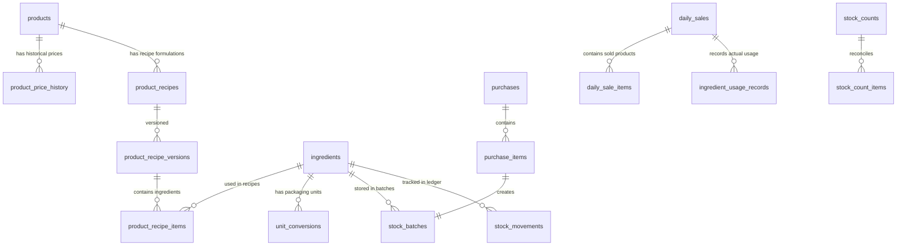

# Database Architecture & Schema Reference

**Application:** Morning Cafe Business Manager  
**Database Engine:** SQLite (via `sqflite`)  
**Storage Model:** 100% Offline Local Device Storage (`morning_cafe.db`)  
**Integrity Strategy:** Enforced Foreign Keys (`PRAGMA foreign_keys = ON`), Double-entry Inventory Ledger, Versioned Recipes, Transactional Rollback Safety.

---

## 1. Architectural Principles

1. **Local Persistent Storage**: All data resides inside the application's private sandboxed SQLite database file on the Android device. No internet connection, cloud server, or remote API is ever required.
2. **Double-Entry Stock Movement Ledger**: Stock quantities are never directly overwritten or mutated without an accompanying entry in `stock_movements`. Every arrival, sale consumption, wastage, correction, and physical count discrepancy is recorded with timestamp, reference ID, unit cost, and total cost.
3. **FIFO Batch Tracking**: Raw ingredient inventory is tracked in distinct batches (`stock_batches`) with individual purchase dates, shelf-life durations (1–7 days), and purchase costs. Consumptions deplete the oldest active non-expired batch first.
4. **Historical Immutability**: Historical sales capture the selling price and recipe version at the exact time of the transaction. Changing product prices or reformulating recipes never modifies past financial results.
5. **Auditing Ledger**: Administrative operations (price edits, cancellations, stock reconciliations, backups) generate append-only audit entries in `audit_logs`.

---

## 2. Entity-Relationship Model (23 Tables)



---

## 3. Detailed Table Definitions

### 3.1 Products & Selling Prices

#### `products`
Stores sellable retail products.
```sql
CREATE TABLE products (
  id INTEGER PRIMARY KEY AUTOINCREMENT,
  name TEXT UNIQUE NOT NULL,
  description TEXT,
  selling_price REAL NOT NULL,
  is_active INTEGER NOT NULL DEFAULT 1,
  created_at TEXT NOT NULL,
  updated_at TEXT NOT NULL
);
```

#### `product_price_history`
Audit trail of retail price changes.
```sql
CREATE TABLE product_price_history (
  id INTEGER PRIMARY KEY AUTOINCREMENT,
  product_id INTEGER NOT NULL,
  old_price REAL NOT NULL,
  new_price REAL NOT NULL,
  changed_at TEXT NOT NULL,
  changed_by TEXT NOT NULL DEFAULT 'owner',
  reason TEXT,
  FOREIGN KEY (product_id) REFERENCES products(id) ON DELETE CASCADE
);
```

---

### 3.2 Raw Ingredients & Packaging Conversions

#### `ingredients`
Inventory catalog of raw materials and base units.
```sql
CREATE TABLE ingredients (
  id INTEGER PRIMARY KEY AUTOINCREMENT,
  name TEXT UNIQUE NOT NULL,
  description TEXT,
  measurement_unit TEXT NOT NULL, -- 'pcs', 'g', 'kg', 'ml', 'l'
  min_stock_level REAL NOT NULL DEFAULT 0.0,
  default_usable_days INTEGER,    -- e.g. 1 to 7 days
  default_storage_info TEXT,
  is_active INTEGER NOT NULL DEFAULT 1,
  notes TEXT,
  created_at TEXT NOT NULL,
  updated_at TEXT NOT NULL
);
```

#### `unit_conversions`
Converts supplier purchase packages into kitchen stock units.
```sql
CREATE TABLE unit_conversions (
  id INTEGER PRIMARY KEY AUTOINCREMENT,
  ingredient_id INTEGER NOT NULL,
  package_unit TEXT NOT NULL,     -- e.g., 'bottle 500ml', 'pack 10pcs'
  stock_unit TEXT NOT NULL,       -- e.g., 'ml', 'pcs'
  multiplier REAL NOT NULL,       -- e.g., 500.0, 10.0
  is_default INTEGER NOT NULL DEFAULT 0,
  FOREIGN KEY (ingredient_id) REFERENCES ingredients(id) ON DELETE CASCADE,
  UNIQUE(ingredient_id, package_unit)
);
```

---

### 3.3 Recipes & BOM (Bill of Materials)

#### `product_recipes`
Parent recipe container for each product.
```sql
CREATE TABLE product_recipes (
  id INTEGER PRIMARY KEY AUTOINCREMENT,
  product_id INTEGER UNIQUE NOT NULL,
  created_at TEXT NOT NULL,
  FOREIGN KEY (product_id) REFERENCES products(id) ON DELETE CASCADE
);
```

#### `product_recipe_versions`
Effective date-versioning container for ingredient recipes.
```sql
CREATE TABLE product_recipe_versions (
  id INTEGER PRIMARY KEY AUTOINCREMENT,
  recipe_id INTEGER NOT NULL,
  version_number INTEGER NOT NULL,
  effective_from TEXT NOT NULL,
  notes TEXT,
  created_at TEXT NOT NULL,
  FOREIGN KEY (recipe_id) REFERENCES product_recipes(id) ON DELETE CASCADE,
  UNIQUE(recipe_id, version_number)
);
```

#### `product_recipe_items`
Individual raw ingredient specifications per recipe version.
```sql
CREATE TABLE product_recipe_items (
  id INTEGER PRIMARY KEY AUTOINCREMENT,
  recipe_version_id INTEGER NOT NULL,
  ingredient_id INTEGER NOT NULL,
  quantity REAL NOT NULL,
  unit TEXT NOT NULL,
  FOREIGN KEY (recipe_version_id) REFERENCES product_recipe_versions(id) ON DELETE CASCADE,
  FOREIGN KEY (ingredient_id) REFERENCES ingredients(id) ON DELETE RESTRICT
);
```

---

### 3.4 Purchases & FIFO Stock Batches

#### `purchases`
Multi-item purchase receipts from suppliers.
```sql
CREATE TABLE purchases (
  id INTEGER PRIMARY KEY AUTOINCREMENT,
  reference_no TEXT UNIQUE NOT NULL,
  purchase_date TEXT NOT NULL,
  supplier_name TEXT,
  status TEXT NOT NULL DEFAULT 'confirmed', -- 'confirmed', 'cancelled'
  total_amount REAL NOT NULL DEFAULT 0.0,
  payment_status TEXT NOT NULL DEFAULT 'paid', -- 'paid', 'pending', 'cancelled'
  payment_method TEXT DEFAULT 'cash',
  notes TEXT,
  created_at TEXT NOT NULL,
  updated_at TEXT NOT NULL
);
```

#### `purchase_items`
Lines on the purchase receipt.
```sql
CREATE TABLE purchase_items (
  id INTEGER PRIMARY KEY AUTOINCREMENT,
  purchase_id INTEGER NOT NULL,
  ingredient_id INTEGER NOT NULL,
  package_quantity REAL NOT NULL,
  package_unit TEXT NOT NULL,
  conversion_multiplier REAL NOT NULL DEFAULT 1.0,
  stock_quantity REAL NOT NULL,
  stock_unit TEXT NOT NULL,
  total_cost REAL NOT NULL,
  unit_cost REAL NOT NULL,
  usable_duration_days INTEGER,
  use_by_date TEXT,
  created_at TEXT NOT NULL,
  FOREIGN KEY (purchase_id) REFERENCES purchases(id) ON DELETE CASCADE,
  FOREIGN KEY (ingredient_id) REFERENCES ingredients(id) ON DELETE RESTRICT
);
```

#### `stock_batches`
FIFO inventory tracking units.
```sql
CREATE TABLE stock_batches (
  id INTEGER PRIMARY KEY AUTOINCREMENT,
  batch_code TEXT UNIQUE NOT NULL,
  ingredient_id INTEGER NOT NULL,
  purchase_item_id INTEGER,
  source_type TEXT NOT NULL, -- 'purchase', 'opening_stock', 'adjustment'
  purchase_date TEXT NOT NULL,
  initial_quantity REAL NOT NULL,
  remaining_quantity REAL NOT NULL,
  unit_cost REAL NOT NULL,
  use_by_date TEXT,
  usable_duration_days INTEGER,
  usable_end_date TEXT,
  status TEXT NOT NULL DEFAULT 'active', -- 'active', 'depleted', 'expired', 'discarded'
  notes TEXT,
  created_at TEXT NOT NULL,
  updated_at TEXT NOT NULL,
  FOREIGN KEY (ingredient_id) REFERENCES ingredients(id) ON DELETE RESTRICT
);
```

#### `stock_movements`
The double-entry inventory ledger.
```sql
CREATE TABLE stock_movements (
  id INTEGER PRIMARY KEY AUTOINCREMENT,
  movement_code TEXT UNIQUE NOT NULL,
  ingredient_id INTEGER NOT NULL,
  batch_id INTEGER,
  movement_type TEXT NOT NULL, -- 'purchase', 'opening_stock', 'production_sales', 'wastage', 'stock_adjustment', 'correction'
  quantity REAL NOT NULL,     -- Positive for inflow, negative for deduction
  unit_cost REAL NOT NULL,
  total_cost REAL NOT NULL,
  movement_date TEXT NOT NULL,
  reference_type TEXT,        -- 'purchase', 'sale', 'wastage', 'stock_count', 'manual'
  reference_id INTEGER,
  notes TEXT,
  created_at TEXT NOT NULL,
  FOREIGN KEY (ingredient_id) REFERENCES ingredients(id) ON DELETE RESTRICT,
  FOREIGN KEY (batch_id) REFERENCES stock_batches(id) ON DELETE SET NULL
);
```

---

### 3.5 Daily Sales & Ingredient Usage

#### `daily_sales`
Daily sales journal header.
```sql
CREATE TABLE daily_sales (
  id INTEGER PRIMARY KEY AUTOINCREMENT,
  sale_date TEXT UNIQUE NOT NULL,
  total_revenue REAL NOT NULL DEFAULT 0.0,
  total_cogs REAL NOT NULL DEFAULT 0.0,
  notes TEXT,
  is_reconciled INTEGER NOT NULL DEFAULT 0,
  created_at TEXT NOT NULL,
  updated_at TEXT NOT NULL
);
```

#### `daily_sale_items`
Product quantities sold on a given date.
```sql
CREATE TABLE daily_sale_items (
  id INTEGER PRIMARY KEY AUTOINCREMENT,
  daily_sale_id INTEGER NOT NULL,
  product_id INTEGER NOT NULL,
  recipe_version_id INTEGER,
  quantity_sold INTEGER NOT NULL,
  unit_price REAL NOT NULL,
  line_total REAL NOT NULL,
  line_cogs REAL NOT NULL DEFAULT 0.0,
  created_at TEXT NOT NULL,
  FOREIGN KEY (daily_sale_id) REFERENCES daily_sales(id) ON DELETE CASCADE,
  FOREIGN KEY (product_id) REFERENCES products(id) ON DELETE RESTRICT
);
```

#### `ingredient_usage_records`
Reconciliation between theoretical recipe explosion and actual consumption.
```sql
CREATE TABLE ingredient_usage_records (
  id INTEGER PRIMARY KEY AUTOINCREMENT,
  daily_sale_id INTEGER NOT NULL,
  ingredient_id INTEGER NOT NULL,
  theoretical_quantity REAL NOT NULL,
  actual_quantity REAL NOT NULL,
  unit TEXT NOT NULL,
  unit_cost REAL NOT NULL DEFAULT 0.0,
  total_cost REAL NOT NULL DEFAULT 0.0,
  variance_quantity REAL NOT NULL DEFAULT 0.0,
  is_confirmed INTEGER NOT NULL DEFAULT 1,
  notes TEXT,
  created_at TEXT NOT NULL,
  FOREIGN KEY (daily_sale_id) REFERENCES daily_sales(id) ON DELETE CASCADE,
  FOREIGN KEY (ingredient_id) REFERENCES ingredients(id) ON DELETE RESTRICT
);
```

---

### 3.6 Wastage, Cash Flow & Adjustments

#### `stock_wastage`
```sql
CREATE TABLE stock_wastage (
  id INTEGER PRIMARY KEY AUTOINCREMENT,
  wastage_code TEXT UNIQUE NOT NULL,
  ingredient_id INTEGER NOT NULL,
  batch_id INTEGER,
  quantity REAL NOT NULL,
  unit TEXT NOT NULL,
  unit_cost REAL NOT NULL,
  total_cost REAL NOT NULL,
  reason TEXT NOT NULL, -- 'expired', 'damaged', 'spoiled', 'dropped', 'prep_error', 'quality'
  wastage_date TEXT NOT NULL,
  notes TEXT,
  created_at TEXT NOT NULL,
  FOREIGN KEY (ingredient_id) REFERENCES ingredients(id) ON DELETE RESTRICT,
  FOREIGN KEY (batch_id) REFERENCES stock_batches(id) ON DELETE SET NULL
);
```

#### `additional_income`
```sql
CREATE TABLE additional_income (
  id INTEGER PRIMARY KEY AUTOINCREMENT,
  transaction_date TEXT NOT NULL,
  received_date TEXT,
  category TEXT NOT NULL,
  description TEXT NOT NULL,
  amount REAL NOT NULL,
  payment_status TEXT NOT NULL DEFAULT 'received',
  notes TEXT,
  created_at TEXT NOT NULL,
  updated_at TEXT NOT NULL
);
```

#### `additional_expenses`
```sql
CREATE TABLE additional_expenses (
  id INTEGER PRIMARY KEY AUTOINCREMENT,
  expense_date TEXT NOT NULL,
  paid_date TEXT,
  category TEXT NOT NULL,
  description TEXT NOT NULL,
  amount REAL NOT NULL,
  payment_status TEXT NOT NULL DEFAULT 'paid',
  receipt_path TEXT,
  notes TEXT,
  created_at TEXT NOT NULL,
  updated_at TEXT NOT NULL
);
```

#### `stock_counts` & `stock_count_items`
Weekly physical inventory reconciliation.
```sql
CREATE TABLE stock_counts (
  id INTEGER PRIMARY KEY AUTOINCREMENT,
  count_code TEXT UNIQUE NOT NULL,
  count_date TEXT NOT NULL,
  status TEXT NOT NULL DEFAULT 'completed',
  notes TEXT,
  created_at TEXT NOT NULL
);

CREATE TABLE stock_count_items (
  id INTEGER PRIMARY KEY AUTOINCREMENT,
  stock_count_id INTEGER NOT NULL,
  ingredient_id INTEGER NOT NULL,
  system_quantity REAL NOT NULL,
  physical_quantity REAL NOT NULL,
  difference_quantity REAL NOT NULL,
  unit_cost REAL NOT NULL,
  adjustment_value REAL NOT NULL,
  adjustment_status TEXT NOT NULL DEFAULT 'adjusted',
  FOREIGN KEY (stock_count_id) REFERENCES stock_counts(id) ON DELETE CASCADE,
  FOREIGN KEY (ingredient_id) REFERENCES ingredients(id) ON DELETE RESTRICT
);
```

#### `audit_logs` & `app_settings`
```sql
CREATE TABLE audit_logs (
  id INTEGER PRIMARY KEY AUTOINCREMENT,
  timestamp TEXT NOT NULL,
  action_type TEXT NOT NULL,
  table_name TEXT NOT NULL,
  record_id INTEGER,
  old_values TEXT,
  new_values TEXT,
  description TEXT NOT NULL
);

CREATE TABLE app_settings (
  key TEXT PRIMARY KEY,
  value TEXT NOT NULL
);
```

---

## 4. Performance Indexes

High-efficiency compound indexes are initialized on database creation:
```sql
CREATE INDEX idx_stock_batches_ing_status ON stock_batches(ingredient_id, status);
CREATE INDEX idx_stock_movements_ing_date ON stock_movements(ingredient_id, movement_date);
CREATE INDEX idx_stock_movements_ref ON stock_movements(reference_type, reference_id);
CREATE INDEX idx_daily_sales_date ON daily_sales(sale_date);
CREATE INDEX idx_daily_sale_items_sale ON daily_sale_items(daily_sale_id);
CREATE INDEX idx_ingredient_usage_sale ON ingredient_usage_records(daily_sale_id);
CREATE INDEX idx_stock_wastage_date ON stock_wastage(wastage_date);
CREATE INDEX idx_additional_income_date ON additional_income(transaction_date);
CREATE INDEX idx_additional_expenses_date ON additional_expenses(expense_date);
CREATE INDEX idx_audit_logs_timestamp ON audit_logs(timestamp);
```
